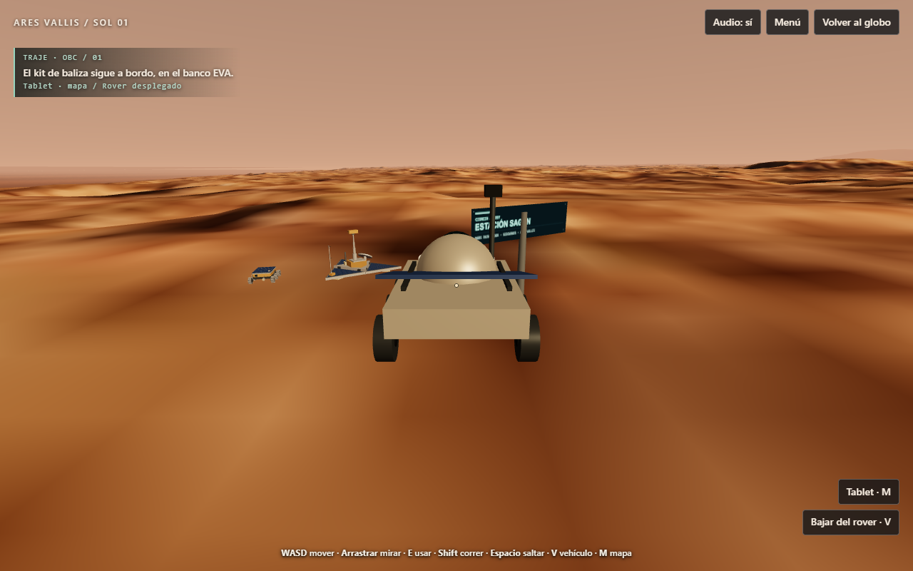
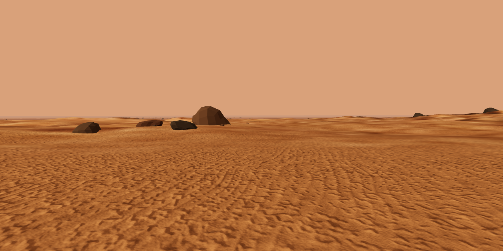

# APEX / MARS · Ares Vallis

Juego de exploración marciana en el navegador. Empieza con el prólogo de la caída,
sigue con una expedición a pie y en rover por el terreno real de Ares Vallis y
termina en la Estación Científica Sagan, reconstruida en el sitio de aterrizaje de
Mars Pathfinder (1997).

## ▶ Jugar ahora

**[https://marioantizana1.github.io/Apex-Mars-The-Game/](https://marioantizana1.github.io/Apex-Mars-The-Game/)**

No hay que instalar nada: abre el enlace en el navegador y pulsa **Iniciar partida**.
Para jugar desde el código, sigue las instrucciones de [Jugar en local](#jugar-en-local).




## Jugar en local

El juego usa módulos ES, `fetch` y datos binarios, así que necesita un servidor
estático (abrir `index.html` con `file://` no funciona):

```powershell
node herramientas/servidor-local.mjs
# Abre http://127.0.0.1:8123/
```

También funciona en cualquier servidor estático o en GitHub Pages (rama
`gh-pages`) sirviendo esta carpeta. La librería Cesium ya está en
`node_modules/cesium`; no hay que compilar nada.

## Controles

| Acción | Teclado / ratón | Táctil |
| --- | --- | --- |
| Caminar | `W` `A` `S` `D` o flechas | Joystick izquierdo |
| Mirar | Arrastrar sobre el terreno | Arrastrar |
| Correr | Mantener `Shift` | Botón **Correr** |
| Saltar | `Espacio` | Botón **Saltar** |
| Interactuar / recoger | `E` | Botón contextual |
| Desplegar / conducir / bajar del rover | `V` | Botón **Vehículo** |
| Mapa de la tablet | `M` | Botón **Tablet** |
| Pausa / menú de cristal | `Esc` o **Menú** | **Menú** |
| Mapa: acercar / alejar | Botones `+` / `−` | Igual |
| Rover: acelerar / girar | `W`/`S`, `A`/`D`; `Shift` turbo | Botón **Vehículo** + joystick |

## Qué incluye

- **Mundo abierto de Ares Vallis** con relieve e imagen reales de HiRISE
  (DTM de 1 m remuestreado a 4 m; ortoimágenes a 2 m) en 112 sectores de 1 km.
  El terreno se carga por sectores alrededor del jugador (ventana de 15 × 15 km)
  con una vista previa de 64 m, y las juntas entre fotos se funden con un albedo
  común. De cerca se aprecia una capa de regolito con grano, grava y ondulaciones
  de polvo. Este detalle y las rocas son procedurales; no son mediciones de
  HiRISE.
- **Bloques y campos de piedra** procedurales: 96 bloques de escala métrica por
  km² (hasta 8 m) y gravas agrupadas a su alrededor, con seis siluetas de roca
  erosionada.
- **Estación Sagan** a 2 km al sureste del impacto, en las coordenadas reales de
  Mars Pathfinder (19,137° N, 33,221° O), con los modelos de Pathfinder y
  Sojourner y el cartel de campaña.
- **Misión de comunicaciones**: lleva la baliza del banco EVA, instálala, cárgala
  en el rover y replántala junto a Pathfinder. Allí, limpia los paneles,
  intenta el encendido, conecta la baliza y establece el enlace con Tierra.
  Puedes replegar y reutilizar la baliza cuando quieras.
- **Rover de seis ruedas** desplegable y conducible en tercera persona, con turbo.
- **Correr y saltar**, con controles de teclado y táctiles.
- **Tablet** con mapa real norte-arriba, cuadrícula de latitud/longitud, zoom,
  navegador, marcador de Sagan y distancias; pausa la partida mientras se consulta.
- **Menú de inicio** abajo a la izquierda sobre el globo, con visitas animadas
  a Olimpo, Jezero, el globo completo y Valles Marineris.
- **Menú de pausa de cristal** con desenfoque de fondo, opciones, créditos y
  vuelta al globo.
- **Audio sintetizado**: viento, pasos, motor del rover y avisos. Sin archivos de
  audio externos.

## Documentación

Toda la documentación está en [`documentacion/`](documentacion/README.md):

1. [Mundo abierto](documentacion/01-mundo-abierto.md)
2. [Datos reales de HiRISE y MOLA](documentacion/02-datos-hirise.md)
3. [Movimiento y rover](documentacion/03-movimiento-y-rover.md)
4. [Tablet y mapa](documentacion/04-tablet-mapa.md)
5. [Menú de inicio y pausa](documentacion/05-menu-y-pausa.md)
6. [Audio y preferencias](documentacion/06-audio-y-preferencias.md)
7. [Arquitectura](documentacion/07-arquitectura.md)
8. [Pruebas](documentacion/08-pruebas.md)
9. [Cómo se hizo](documentacion/09-como-se-hizo.md)
10. [Pendientes y límites conocidos](documentacion/10-pendientes.md)

## Datos y generación

Los datos de juego ocupan unos 21 MB en `datos/ares/`, más 4,3 MB de teselas
MOLA en `datos/bloques/relieve/5/`. No se guardan los originales (~450 MB).
Para regenerarlos:

```powershell
node herramientas/descargar-datos-ares.mjs --destino D:\datos-fuente-ares
python herramientas/datos-ares.py --fuente D:\datos-fuente-ares
python herramientas/mosaico-ares.py
```

El script de descarga trae el DTM y las dos ortoimágenes HiRISE del sitio
Pathfinder; el generador hace el remuestreo, los sectores, las texturas, la
vista previa de 64 m, el peso de fusión de 16 m y la malla MOLA. El mosaico
genera el albedo común que funde las juntas entre fotografías. Todo es
reproducible y está documentado en [02-datos-hirise.md](documentacion/02-datos-hirise.md).

## Pruebas

```powershell
node --test --test-isolation=none
```

Son 39 pruebas en Node, sin navegador. Ver [08-pruebas.md](documentacion/08-pruebas.md).

## Créditos

- Relieve e imagen de Ares Vallis: **HiRISE**, NASA/JPL/University of Arizona
  (DTM `DTEEC_002391_1995_001890_1995_A01`, ortoimágenes `PSP_002391_1995_RED_C`
  y `PSP_001890_1995_RED_C`).
- Relieve global: **MOLA**, NASA/JPL/MOLA Science Team.
- Globo: **CesiumJS** (Cesium GS, Apache 2.0).
- Escena 3D: **three.js** (MIT).
- Modelos Pathfinder y Sojourner: reconstrucción original del proyecto
  (`modelos/generar.py`).
- La misión real **Mars Pathfinder** (1997) como inspiración.
