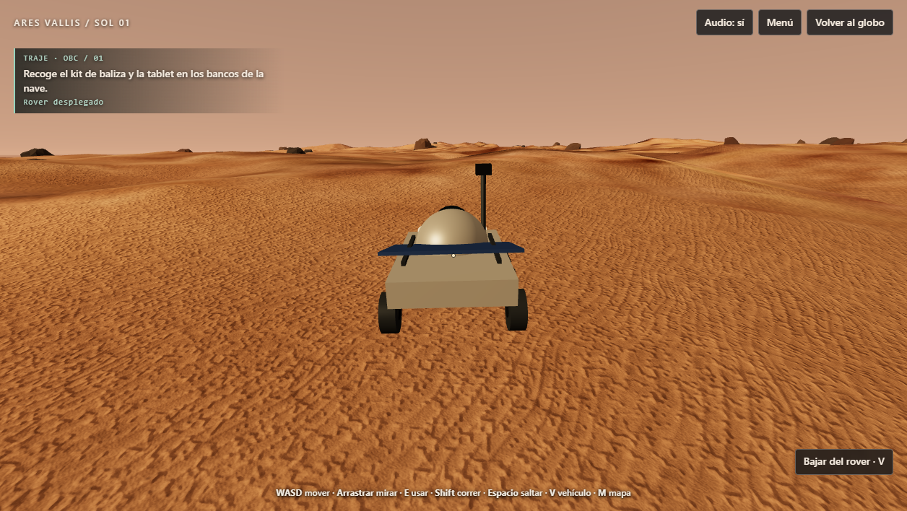
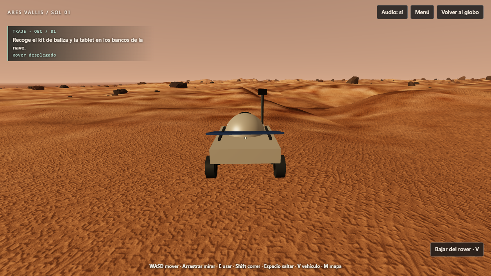

# 03 · Movimiento a pie y vehículo

## El traje

El jugador empieza tumbado en la cabina, como antes. La exploración usa el mismo
controlador de primera persona de la base jugable original (`historia-explora.js`)
con estas ampliaciones:

| Estado | Velocidad |
| --- | ---: |
| Dentro de la nave | 2,02 m/s |
| Fuera, andando | 2,85 m/s |
| Corriendo (×1,7) | 4,85 m/s fuera · 3,43 m/s dentro |
| En el aire | 55 % de la velocidad horizontal |

- **Correr**: mantener `Shift` o el botón táctil **Correr**.
- **Saltar**: `Espacio` o **Saltar**. Impulso vertical 4,3 m/s; gravedad 11,5 m/s²;
  salto corto y controlable. Se puede seguir moviendo en el aire.
- **Cámara**: `look` gira con el arrastre; el giro de las flechas izquierda y
  derecha sigue funcionando andando.
- **Interactuar**: `E`; el punto de mira y la distancia deciden la acción.

La distinción **dentro/fuera** se hace con `exteriorZone`, que se recalcula cada
fotograma según el casco (z ≈ −3,98 a `Z_FIN_CASCO`, |x| < 1,97). La variable
`outside` solo recuerda si el jugador ya ha salido alguna vez por la rampa, para
el mensaje de bienvenida; **no** decide la velocidad ni el rover. Esto corrige el
comportamiento antiguo, en el que volver a entrar en la nave seguía usando la
velocidad del exterior. La prueba de la esclusa se ajustó para usar la zona
actual (`zone.at(-1)`) en lugar de “alguna vez fuera”, que era el supuesto viejo.

### Suelo y colisiones

- `floorY(x, z)` devuelve la cubierta de la cabina (0,59 m), la rampa o la altura
  real del terreno. La plataforma del impacto está aplanada a 0, y Sagan a +8,89.
- El jugador no puede atravesar el casco: las reglas de la esclusa, el puente y
  las puertas siguen siendo las originales.
- `allowed(x, z, radio)` impone además:
  - el cuadrado del mundo de ±24.000 m;
  - las colisiones del sitio Sagan (lander 2,2 m, Sojourner 1,3 m, cartel 0,6 m);
  - la baliza de campo anclada, si existe.
- El movimiento se resuelve por ejes (`x` y luego `z`) para deslizar por paredes.

### Controles táctiles

El joystick de la cabina sigue siendo el mismo. En el HUD exterior hay:

- **Correr**: mantener pulsado (aria-pressed);
- **Saltar**: pulsación;
- **Vehículo**: despliega/sube/baja;
- **Tablet**: abre el mapa cuando se ha recogido.

## El rover

### Modelo

Rover procedural de seis ruedas construido en three.js, sin archivos externos:

- chasis de 2,5 × 0,55 × 3,7 m, cúpula, panel solar azul, mástil con cámara,
  dos faros, seis ruedas con buje y brazos;
- las ruedas giran al avanzar; el vehículo se inclina según la normal real del
  terreno;
- material compartido por piezas; no tiene texturas propias.

### Desplegar

`V` (o **Vehículo**) cuando el jugador está **fuera**. Se busca un sitio libre de
3,8 m a la derecha, 4,6 m delante o 3,8 m a la izquierda; se comprueba
`allowed(...)` con radio 1,4 (nave, esclusa, Sagan, límite). Si no hay sitio, se
avisa. Al desplegarlo, el jugador **monta** automáticamente.

Si ya está desplegado y estás a menos de 4,6 m, `V` sube; si estás lejos, se
indica la distancia. `V` mientras conduces baja al jugador a un lado (se prueban
derecha, izquierda y detrás) y deja el rover aparcado.

### Conducir

- `W`/`S` o `↑`/`↓`: acelerador y freno/atrás.
- `A`/`D` o `←`/`→`: giro; el sentido se invierte al dar marcha atrás.
- `Shift`: turbo.
- `V`: bajar (solo con alguna rueda en el suelo).
- El rover respeta `allowed` con radio 1,3. No puede entrar en el casco ni en el
  sitio Sagan.

Constantes de propulsión (marco horizontal):

| Parámetro | Valor |
| --- | ---: |
| Aceleración | 9 m/s² (16 con turbo) |
| Velocidad máxima | 18 m/s (26 con turbo) |
| Marcha atrás | −5 m/s |
| Fricción al soltar | `exp(−1,3·dt)` |
| Giro | 0,9–1,5 rad/s según velocidad |
| Radio de colisión | 1,3 m |
| Altura de los ojos a pie | 1,51 m |

### Suspensión y gravedad marciana

El rover ya no está "imantado" al suelo. `rover-fisica.js` integra un bastidor
con **seis suspensiones unilaterales** muestreadas en la posición real de cada
rueda:

| Parámetro | Valor |
| --- | ---: |
| Gravedad | **3,71 m/s²** (Marte) |
| Rigidez `K` | 48 N/m por rueda (masa unidad) |
| Amortiguación `C` | 8 |
| Extensión libre | `g/K` ≈ 0,077 m |
| Tope de compresión | 0,24 m |
| Submuestreo vertical | 120 Hz (`ceil(dt·120)` pasos) |

- La fuerza sólo empuja desde el suelo: una rueda sin contacto **no** tira del
  vehículo, así que al coronar una cresta el chasis sale volando y cae en
  parábola marciana (una caída de 1 m tarda 0,73 s, no los 0,45 s terrestres).
- La tracción es proporcional a las ruedas en contacto (`contactos/6`): en el
  aire no se acelera ni se gira.
- Las pendientes se leen en el marco girado del chasis (lateral y longitudinal)
  con filtro exponencial; la normal del rover se orienta con ellas.
- Las seis ruedas se animan con el recorrido real de su amortiguador
  (`0,44 + recorrido`), y la cámara de tercera persona sigue al chasis con un
  muelle suave, no al terreno: no se pega al suelo ni tiembla con cada bache.
- La telemetría (`estado()` y `ui.position`) expone `roverAltura`,
  `roverContactos`, `roverVelVertical` y `roverEnVuelo`.
- `rover-fisica.test.mjs` comprueba el apoyo en llano sin hundirse, la caída libre
  a 3,71 m/s², el despegue al coronar una loma, el aterrizaje sin atravesar el
  terreno y la lectura de pendientes en el marco girado.

Las capturas se tomaron conduciendo con turbo sobre el relieve real de Ares
Vallis en Edge headless, con el tiempo de simulación avanzado desde CDP.

Para repetir la prueba en el navegador, la partida se puede exponer con
`?depurar=1`: `window.__apexJuego.simulacion` devuelve el simulador y permite
llamar a `estado()`, `look()`, `move()`, `vehicle()` e `update()` sin tocar el
DOM.

La cámara de conducción sigue siendo de **tercera persona cercana** (8,2 m
detrás). El arrastre mueve el punto de vista alrededor del rover
(`miradaYaw`/`miradaPitch`); no cambia el rumbo de conducción.

### Sonido y HUD

- El motor sintetizado sube de ganancia y tono con la velocidad; el viento y los
  pasos siguen activos a pie.
- El botón **Vehículo** muestra el estado: *Desplegar vehículo*, *Subir al rover*
  o *Bajar del rover*.
- El objetivo del HUD pasa a indicar la distancia y el rumbo a Sagan cuando la
  misión de la baliza está resuelta.

### Depuración

`crearExploracion` devuelve `estado()` (posición, pie, `outside`, `exteriorZone`,
rover, etc.) y el campamento expone el simulador en `camp.simulacion` en el
arranque de prueba. La prueba `historia-mundo.test.mjs` recorre la esclusa, monta
el rover, lo conduce y comprueba que se mueve; también prueba salto, carrera y
tablet.

## Misión de superficie: montar la estación junto a la nave

Tras la llamada con Houston, la misión cambia de sentido: ya no basta con hablar
desde Sagan, hay que montar una **estación de superficie** fuera de la nave.

1. En Sagan, **recoge Pathfinder** (`E` sobre el lander) y **repliega la baliza**
   (`E` sobre su base). Puedes llevar los dos equipos a la vez: el lander viaja en
   la mano o sobre el rover y la antena va en el maletín/estiba.
2. Vuélvete a la nave. El objetivo recuerda la distancia a la rampa y la flecha de
   rumbo (si está activa) apunta al destino de misión en lugar de a Sagan.
3. A pie, apunta a cada soporte marcado junto a la rampa —Pathfinder al oeste
   `(−4, −8)`, baliza al este `(4, −8)`— y usa la acción de montaje. El orden es
   libre.
4. Con ambos equipos montados, entra por la esclusa y consulta el **diagnóstico de
   vuelo** del puente: confirmará la comunicación orbital y abrirá el cierre de la
   demo, con la opción de seguir explorando o volver al globo.

`estado()` expone `ubicacionPathfinder` (`sagan`, `transporte`, `exterior`),
`balizaRecuperada`, `balizaMontada`, `enlaceOrbitalListo` y `regresoANave`. El
simulador devuelve además `siguienteRadio()` (avanza el diálogo con Houston) y
`enlaceOrbitalListo()`, para probar el flujo completo sin mirar el DOM.

## Lo que no hace (todavía)

- No hay daño, combustible, vuelco ni caída desde grandes alturas.
- El rover no se rompe al aterrizar fuerte; la suspensión absorbe y no hay daño.
- La cámara no hace colisión contra el casco al montar cerca de la nave.
- La exploración y el rover admiten [dos mandos Xbox compartidos](13-voz-y-mando.md); no hay segundo avatar.
- Las rocas no bloquean el paso (solo son visuales), salvo las piezas de Sagan y
  la baliza.
