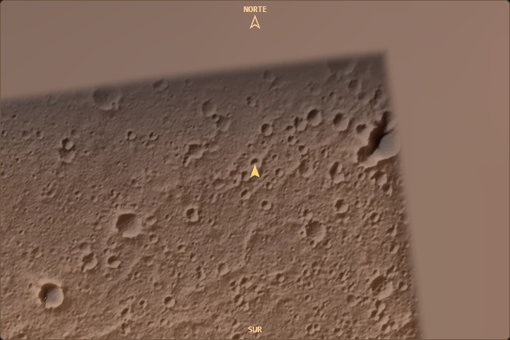
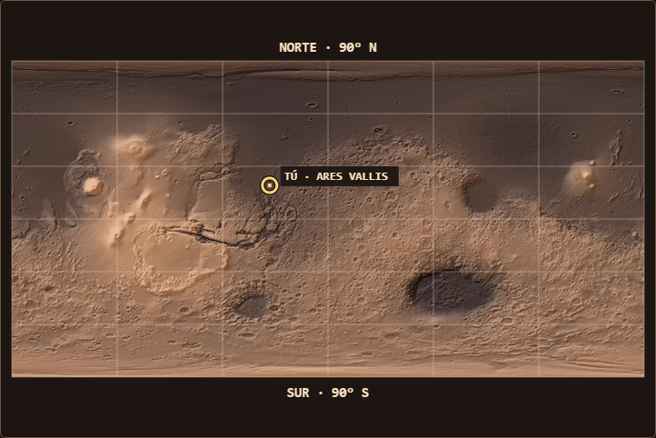

# 04 · Tablet y mapa de Ares Vallis

## La tablet

La tablet es un objeto de la cabina que ya existía en la escena original. Al
recogerla (mirar al banco EVA y pulsar `E`) se guarda en el equipo:

- el HUD muestra **Tablet · mapa** en el inventario;
- aparece el botón **Tablet · M** arriba a la derecha;
- `M` o el botón abren el mapa;
- sin tablet, `sim.mapa()` responde “Necesitas la tablet del banco EVA para
  consultar el mapa.” y no abre nada.

El mapa es un `<dialog>` nativo con `showModal`, de 720 × 480 internos y
adaptado al ancho de la pantalla. Mientras está abierto:

- `ui.paused()` devuelve `true` y la simulación deja de actualizar el movimiento,
  la esclusa, el rover y el audio de motor/pasos;
- el audio general se silencia (`mix()` pone el volumen maestro a 0);
- `Esc`, el botón **Cerrar mapa**, la “X” del diálogo o un clic en el fondo lo
  cierran y devuelven el foco al canvas.

## Contenido del mapa

Está orientado **norte arriba** (`−z` arriba, `+x` a la derecha), siempre
independientemente de hacia dónde mire la cámara, y **el sur queda abajo**: el
mapa dibuja un arco con la letra `NORTE` arriba y `SUR` abajo.

- **Relieve dibujado**: tres capas de sombreado hipsométrico generadas con
  `herramientas/cartas-tablet.py` a partir de los DEM locales
  (`datos/cartas/marte.webp`, `regional.webp` y `ares.webp`). El planisferio usa
  el mosaico MOLA global; la capa regional cubre ±24,8 km con el MOLA de 10 km por
  muestra; y la capa de detalle usa el DTM HiRISE del sitio (7 × 16 km). La luz
  viene del noroeste y se combina con una rampa de color por altura.
- **Mapa planetario 2D**: el botón **Marte completo** alterna entre el mapa local
  y un planisferio con la **posición actual** del jugador marcada en Ares Vallis,
  los polos norte y sur rotulados y la escala global. Volver al mapa local restaura
  la leyenda, el zoom y el botón de centrado.
- **Cuadrícula real**: líneas de latitud y longitud calculadas a partir del
  origen real del impacto (`ORIGEN.lon = 326,7576`, `lat = 19,164`) y de las
  escalas `GEO` (`55.977 m/°` en longitud, `59.252 m/°` en latitud). El paso se
  adapta al zoom (0,002° a 0,5°) para que las etiquetas no se solapen.
- **NAVE**: cuadrado en `(0, 0)`.
- **SAGAN**: rombo cian en `(1200, 1600)`; si queda fuera de la vista se pega al
  borde y se etiqueta.
- **BALIZA**: punto naranja cuando la baliza está instalada en el campo.
- **TÚ**: triángulo amarillo con halo, orientado al rumbo real del jugador o del
  rover. Se dibuja el último para que no lo tapen las demás marcas.
- **Escala**: barra de 100 m a 25 km según el zoom y texto `1 km ≈ N px`.
- **Lectura**: posición en latitud/longitud, altura relativa, estado (a pie,
  parado, rover), distancia y rumbo a Sagan, estado de la baliza y de Pathfinder.
- **Zoom**: `+` / `−` entre 2, 6, 12, 25, 50, 100, 250 y 600 m/píxel; por defecto
  6 m/píxel.
- **Centrar en Sagan**: alterna el centro del mapa entre Sagan y el jugador; el
  texto del botón cambia a **Centrar en mí**.
- **Ruta opcional**: si la preferencia `rumbo` está activa, se dibuja una línea
  discontinua del jugador al destino de misión (Sagan, o los soportes de la nave
  cuando toca montar la estación).

### Flecha de rumbo en el HUD

La preferencia **Flecha de rumbo a Sagan** (apagada por defecto) añade un pequeño
HUD en el centro de la pantalla con una flecha `➤` y el texto
`Sagan · 2,0 km · sureste`. La flecha se rota con el rumbo real
(`atan2(dx, −dz)`), de modo que apunta a Sagan aunque el jugador gire. Se puede
activar o desactivar en las **Opciones** del menú de inicio o de la pausa; el
cambio se guarda y el evento `apex:preferencias` actualiza ambos menús.

### Cómo llegar a Sagan

1. Recoge la tablet en la cabina.
2. Abre el mapa con `M`.
3. Sagan aparece 2 km al sureste, con rumbo 143° desde el impacto.
4. Si activas la flecha de rumbo, síguela; si no, orienta la brújula y usa la
   distancia del mapa.
5. En rover: `V`, luego `W`/`S` y `A`/`D`; `Shift` turbo. A 18–26 m/s son unos
   2 minutos (o menos con turbo).

### Capturas





### Generación de las cartas

Las tres capas se generan una sola vez desde los DEM locales:

```powershell
python herramientas/cartas-tablet.py
```

Escribe `datos/cartas/marte.webp`, `regional.webp` y `ares.webp` con sombreado
noroeste, rampa de color por altura y la máscara del DTM en la capa de detalle.
Necesita `numpy` y `Pillow`.

## Cálculo de coordenadas

El mapa usa:

```text
lat = ORIGEN.lat - z / GEO.mPorGradoLat
lon = ORIGEN.lon + x / GEO.mPorGradoLon
```

`lon` se normaliza a −180…180 para mostrarla como 33°… O. Las etiquetas se
formatean en grados, minutos y segundos (`19°09′50″N`). La cuadrícula es
aproximada (escala local constante), suficiente para orientarse en 48 km.

## Límites conocidos

- No se puede arrastrar ni desplazar el mapa libremente: se centra en el jugador
  o en Sagan y se acerca/aleja.
- El relieve es sombreado de una sola luz y una rampa de color: sirve para leer
  valles y crestas, no es una ortofoto a color real.
- Las cartas se descomprimen al abrir la tablet por primera vez; hasta que
  terminan de cargar, el mapa dibuja la cuadrícula y las marcas (`cargando
  relieve…`). Si un archivo falta, el mapa sigue funcionando sin ese relieve.
- En pantallas muy bajas el diálogo hace scroll; en móvil el canvas se adapta al
  ancho.
- La lectura de altura es relativa al impacto; no es una altitud absoluta.
- El mapa no marca las rocas ni la baliza de campo una vez montada.
