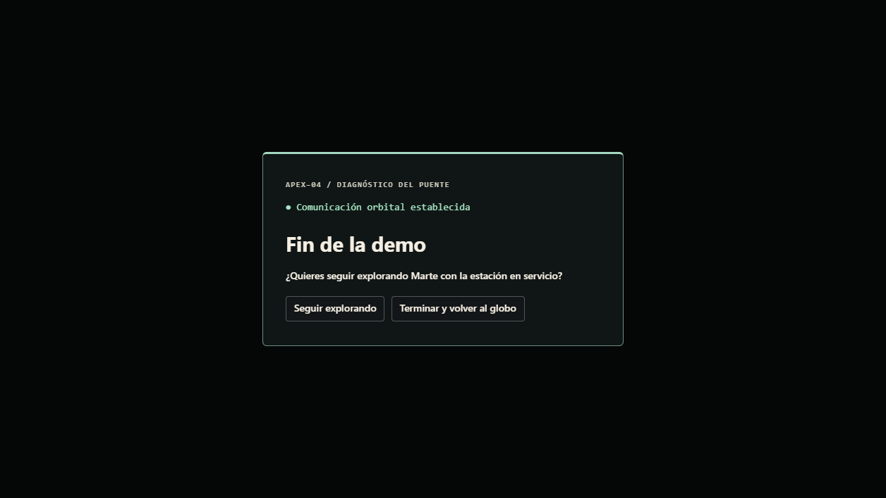
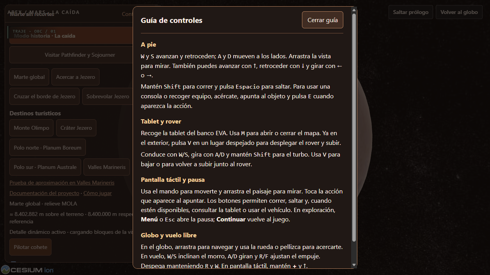

# 05 · Menú de inicio y menú de pausa

## Menú de inicio (globo)

El menú aparece **abajo a la izquierda** sobre el globo de Marte al cargar la
página. Es una tarjeta de cristal oscuro con cinco botones:

1. **Iniciar partida** — Monte Olimpo.
2. **Controles** — guía de controles completa (ver abajo).
3. **Opciones** — Cráter Jezero.
4. **Ver el globo** — Marte completo.
5. **Créditos** — Valles Marineris.

### Guía de controles

**Controles** abre el mismo `<dialog>` (`#guia-controles`) desde el menú de inicio
y desde el de pausa, para que no haya que adivinar las teclas. Recoge a pie,
tablet y rover, vuelo libre y mandos táctiles. La guía:

- no cambia el estado de la partida: la pausa sigue abierta debajo;
- detiene la propagación de `M`, `E`, `Espacio` y `Esc` mientras está abierta, de
  modo que leer no mueve al personaje ni cierra la pausa;
- al cerrarse devuelve el foco al botón que la abrió.
- `guia-controles.js` contiene la lógica y `guia-controles.test.mjs` comprueba
  ambos accesos, el foco y el aislamiento de los atajos.

### Vistas previas

Al pasar el puntero o el foco por una opción (con un retardo de 180 ms) la cámara
vuela al destino **sin arrancar el sobrevuelo**:

| Opción | lon | lat | altura | pitch | duración |
| --- | ---: | ---: | ---: | ---: | ---: |
| Iniciar / Olimpo | −133,2° | 18,31° | 210 km | −88° | 3,6 s |
| Opciones / Jezero | 77,4509° | 18,4446° | 22 km | −62° | 3,2 s |
| Ver el globo | 73° | 16° | 8.400 km | −90° | 3,0 s |
| Créditos / Marineris | −78,5° | −7,7° | 420 km | −80° | 3,4 s |

### Al hacer clic

- **Iniciar partida**: cancela cualquier vuelo, oculta el menú y pulsa el botón
  del modo historia; empieza el prólogo **La caída**. El prólogo se puede saltar
  con **Saltar prólogo** y después arranca la exploración EVA.
- **Opciones**: abre el panel de preferencias (sonidos, imágenes científicas,
  flecha de rumbo) y lanza un **sobrevuelo de Jezero** en dos tramos:
  (77,18, 18,46, 3,2 km) → (77,86, 18,43, 2,8 km), 5 s + 7 s.
- **Ver el globo**: vuelve a Marte completo; el menú sigue visible.
- **Controles**: abre la guía de controles sin cambiar de vista ni empezar la
  partida.
- **Créditos**: abre los créditos y lanza un **sobrevuelo de Valles Marineris**
  en dos tramos: (−98,−16, 130 km) → (−60,−3, 110 km), 6 s + 8 s.
- **Volver a los destinos** (en los paneles) o **Volver** devuelven la cámara a
  Marte completo sin ocultar el menú.

Con `prefers-reduced-motion` se usa `setView` inmediato y no se animan los
sobrevuelos. Si Cesium o el DOM no están disponibles, `crearMenu` devuelve una
API inactiva y no rompe la página.

### Cuándo se ve

- Al cargar la página, sobre el globo.
- El **panel de controles** del globo se retira mientras el menú está visible
  (`body:has(#menu:not([hidden])) #panel { display:none }`) para no solaparse.
- Al empezar la historia, el menú se oculta (por el callback `ocultar()` y por el
  evento `apex:historia-abierta`). Durante el vuelo (`#vuelo-panel`) también se
  oculta por CSS.
- Al volver al globo desde la historia, el callback `alCerrar` de `crearHistoria`
  llama a `menu.mostrar()` y el menú vuelve a aparecer con Marte completo. Es la
  entrada para reiniciar o cambiar opciones.
- El menú **no** es el menú de pausa: dentro de la partida el menú es el de
  cristal que se describe abajo. El menú grande es solo de arranque/regreso.

### Implementación

- `menu.js`: `crearMenu(C, viewer, ellipsoid, opciones)` devuelve
  `{ ocultar, mostrar, actualizar, destruir }`; gestiona vistas, sobrevuelos,
  créditos, preferencias y estados `aria-pressed`.
- `menu.css`: tarjeta fija abajo-izquierda, responsive, `backdrop-filter`,
  `:focus-visible`, `prefers-reduced-motion`, `forced-colors`.
- `index.html`: el marcado `#menu`, `#menu-opciones`, `#menu-creditos`,
  `#menu-estado`.
- `globo.js`: crea el menú, pasa `iniciar`, `reduced`, `ciencia` y
  `detenerVuelo`; registra el cierre de la historia para mostrar el menú.

### Verificación

La integración DOM se comprobó en la página real con Edge headless + CDP: menú
visible al cargar, panel oculto, **Iniciar partida** → historia con canvas
three.js, **Saltar prólogo** → EVA, pausa abrir/cerrar y **Volver al globo** →
menú visible. El canvas Cesium no se pudo verificar visualmente en headless
(SwiftShader); conviene una pasada final en navegador real.

## Menú de pausa (cristal)

Dentro de la exploración, `Esc` o el botón **Menú** de la barra abre una capa a
pantalla completa:

- fondo oscuro con **desenfoque** (`backdrop-filter: blur(12px)`) y el panel de
  cristal con `blur(24px) saturate(1.25)`;
- título **Partida en pausa**;
- **Continuar**, **Controles**, **Opciones**, **Créditos**, **Volver al globo y
  menú**.

Mientras está abierto, la simulación se pausa (`ui.paused()`), el viento, los
pasos y el motor se silencian y el foco queda en **Continuar**. `Esc` cierra;
pulsar el fondo también cierra.

- **Opciones** abre las tres casillas: sonidos, imágenes científicas y flecha de
  rumbo. Los cambios se guardan y se propagan al menú de inicio.
- **Créditos** muestra el listado (HiRISE, MOLA, Cesium, three.js, modelos y
  agradecimientos) generado al abrir.
- **Volver al globo y menú** cierra la pausa, pulsa *Volver al globo* y, al
  cerrarse la historia, el menú de inicio vuelve a aparecer. Desde ahí se puede
  empezar otra partida.

### Integración con la historia

`historia.js` captura `Esc` mientras la historia está activa. Ahora, antes de
cerrar la historia, llama a `campaign.escape?.()`:

- si hay mapa abierto, lo cierra;
- si hay pausa, la cierra;
- si hay EVA, abre la pausa;
- en el prólogo cinematográfico o en la visita de Pathfinder (sin EVA), devuelve
  `false` y la historia se cierra como antes.

El botón **Saltar prólogo**, **Volver al globo** y los controles de la barra se
mantienen.

## Final de la demo

Al consultar el diagnóstico del puente con Pathfinder y la baliza ya montados
fuera de la nave, la escena abre `#fin-demo`:

- `showModal` con fundido a negro (`::backdrop` animado) y aparición posterior del
  texto, ambos en CSS; con `prefers-reduced-motion` no hay animación;
- título **Fin de la demo** y la pregunta de si se quiere seguir explorando;
- **Seguir explorando** cierra el diálogo, devuelve el foco al canvas y la partida
  continúa con el objetivo “Comunicación orbital establecida”;
- **Terminar y volver al globo** pulsa *Volver al globo*, cerrando la historia y
  mostrando el menú de inicio;
- mientras está abierto, `ui.paused()` devuelve `true` (la simulación no avanza),
  `Esc` no lo cierra y las teclas no llegan a la escena; el diagnóstico no vuelve
  a abrirlo una segunda vez.
- `fin-demo.js` contiene la lógica y `fin-demo.test.mjs` comprueba el marcado, la
  animación, las dos salidas y el cableado con la escena.





Ambas capturas se tomaron en Edge headless con los diálogos abiertos sobre la
página real (historia visible simulada desde CDP).

## Flujo completo

```text
Carga
 └─ globo + menú de inicio (abajo izquierda)
      ├─ Iniciar partida → prólogo La caída → (saltar) → EVA en la nave
      │      └─ explorar → salir → rover / a pie → Sagan
      │             └─ Esc / Menú → pausa de cristal
      │                    ├─ Continuar
      │                    ├─ Opciones (sonido, ciencia, rumbo)
      │                    ├─ Créditos
      │                    └─ Volver al globo y menú → menú de inicio
      ├─ Opciones → Jezero + sobrevuelo
      ├─ Ver el globo → Marte completo
      └─ Créditos → Valles Marineris + sobrevuelo
```

## Límites conocidos

- El menú de inicio se verificó por código y con DOM simulado, pero **no** se
  pudo capturar el globo Cesium en navegador headless: SwiftShader/Edge falla al
  renderizar el globo (error interno `this.skyBox.update`). En un navegador real
  el globo ya funcionaba antes de estos cambios; conviene una comprobación visual
  final.
- Los créditos son genéricos (no hay nombres de autoría reales); se pueden
  personalizar en `menu.js` y en `crearCreditosPausa`.
- El menú de inicio no reaparece automáticamente al recargar la partida (no hay
  guardado); al volver al globo sí.
- La pausa no atrapa el foco con un focus trap completo; es una capa con botones
  reales y `aria-modal`.
- El panel de controles del globo queda oculto mientras el menú está visible.
